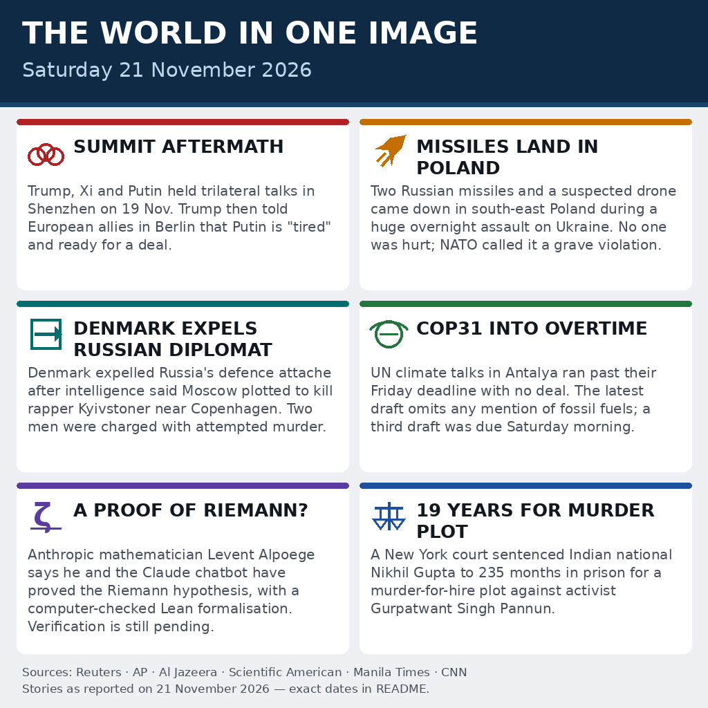

# The World in One Image — Saturday 21 November 2026

[](https://make.fun/bounty/news-image-20261121)
[](https://make.fun/bounty/news-image-20261121)
[](https://make.fun/bounty/news-image-20261121)

One 1024×1024 image summing up the world news as reported on Saturday
21 November 2026. The image shows six stories; the date notes below give
each story's actual date — most of these concern events or announcements
of 19–20 November that were first reported on 20–21 November and carried
in 21 November morning digests. Nothing in the image claims a story
happened on 21 November unless it did.



## The six stories

1. **Summit aftermath** — Trump, Xi and Putin held trilateral talks in
   Shenzhen on **19 November 2026**; Trump then dialled into a Berlin
   meeting of Ukraine's European allies and told them Putin is "tired"
   and ready for a deal. First reported 20 November.
   Source: [CNN](https://www.cnn.com/2026/11/20/europe/russia-ukraine-putin-trump-intl-hnk)
2. **Missiles land in Poland** — Two Russian missiles and a suspected
   drone came down in south-east Poland during a huge overnight assault
   on Ukraine; PM Donald Tusk called it a deliberate provocation and
   NATO called it a grave violation. Nobody was hurt. The overnight
   assault was on **19–20 November**, reported 20–21 November.
   Source: [AP](https://www.reflector.com/news/national/russian-missiles-land-in-poland-as-europe-held-military-drills-nearby-nato-calls-it-a/article_66cef298-02e8-53b4-94cf-1d56092ea027.html)
3. **Denmark expels Russian diplomat** — Denmark expelled Russia's
   defence attache after its PET intelligence service said Moscow
   plotted to kill Ukrainian-American rapper Kyivstoner at a concert
   near Copenhagen; two men were charged with attempted murder.
   Announced **21 November 2026**.
   Source: [Al Jazeera](https://www.aljazeera.com/news/2026/11/21/denmark-expels-russian-diplomat-over-alleged-plot-to-kill-ukrainian-rapper)
4. **COP31 into overtime** — UN climate talks in Antalya spilled past
   their Friday (**20 November**) deadline with no deal; the latest
   draft omits any mention of fossil fuels; a third draft was promised
   for **Saturday morning, 21 November** — the only item in this image
   actually dated 21 November.
   Source: [Manila Times](https://www.manilatimes.net/2026/11/21/world/americas-emea/crunch-time-for-cop31-but-no-agreement-in-sight/2474972/amp)
5. **A proof of Riemann?** — Anthropic mathematician Levent Alpoege
   said he and the Claude chatbot have proved the Riemann hypothesis,
   maths' most famous open problem, releasing a computer-checked Lean
   formalisation. This is a **claim, not a verified result**:
   independent verification is still pending. Announced
   **20 November 2026**.
   Source: [Scientific American](https://www.scientificamerican.com/article/anthropic-mathematician-claims-to-prove-riemann-hypothesis-most-famous-problem-in-all-of-math/)
6. **19 years for murder plot** — A New York court sentenced Indian
   national Nikhil Gupta to 235 months in prison for a murder-for-hire
   plot against Sikh activist Gurpatwant Singh Pannun, directed,
   prosecutors said, by an Indian government employee. Sentenced
   **20 November 2026**.
   Source: [Reuters](https://www.reuters.com/world/us/indian-man-sentenced-more-than-19-years-us-plotting-kill-sikh-separatist-2026-11-20/)

## How it works

- `draw_infographic.py` (build-time only, uses Pillow) draws
  `entry.png` from scratch: a header band with the title and date, six
  story cards in a 2×3 grid, each with a distinct geometric icon drawn
  with Pillow shapes (no external images), and a footer naming the
  sources. Text is wrapped against the real font metrics so nothing
  overflows its card.
- `main.py` (Python 3.13, standard library only, no network) copies the
  `entry.png` sitting next to it into `$MAKEFUN_OUTPUT_DIR/entry.png`,
  creating the directory if needed. The output bytes are identical to
  the bundled file on every run.

## Local verification

```bash
python3 draw_infographic.py
python3 -c "from PIL import Image; im = Image.open('entry.png'); print(im.size)"
ls -l entry.png          # must be 1024x1024 and <= 1 MiB
MAKEFUN_OUTPUT_DIR=/tmp/out1 python3 main.py
MAKEFUN_OUTPUT_DIR=/tmp/out2 python3 main.py
sha256sum entry.png /tmp/out1/entry.png /tmp/out2/entry.png
# all three hashes must be identical
```
